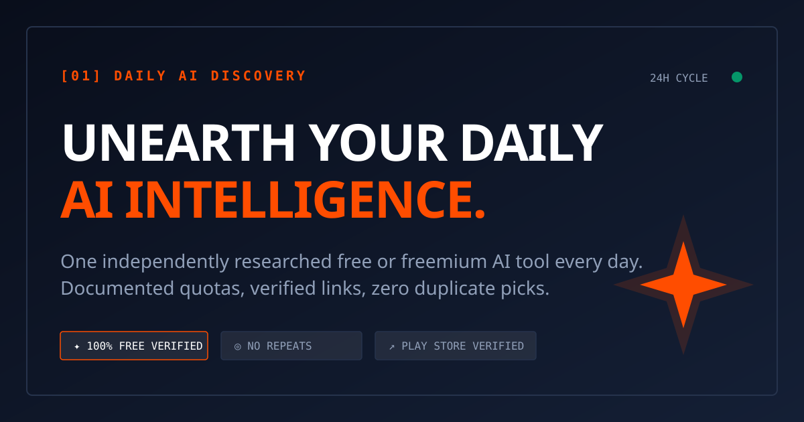

# Daily AI Discovery

> **One useful free or freemium AI discovery, researched every day.**  
> Continuous 24h curation cycle · Zero duplicate ledger · Field-tested quotas · Pakistan & South Asia accessibility audits · Zero sponsors.



---

## Highlights & Features

- **24-Hour Editorial Cycle**: Hand-researched AI tools covering weekly category rotations (Audio, Image, Video, Animation, Developer/CLI, Hidden Gems, Reasoning).
- **Interactive Brutalist UI**: Custom typography, 3x preview image showcase, verified destination badges (Official Website, Direct Sandbox, Google Play Store app verification).
- **Google Sheets Live Sync**: One-click OAuth Google Workspace integration to push curated discoveries directly into your private or team Google Sheets.
- **Automated Auto-Export on Publish**: Toggle on the research form to automatically append published discoveries to your connected Google Sheet.
- **Real-Time Sheets URL Regex Validation**: Instant visual badge (`✓ Valid ID format` / `⚠️ Invalid link`) as you paste or type.
- **One-Click CSV & JSON Vault Export**: Download the entire verified discovery dataset instantly to your computer (`.csv` or `.json`).
- **RSS 2.0 & JSON Feed 1.1**: Syndicate discoveries to Feedly, Slack, Discord bots, and RSS readers via `/feed.xml` and `/feed.json`.
- **Pakistan-Verified Filter Switch**: One-click archive filter to reveal tools confirmed to work without regional VPNs or foreign phone numbers.
- **Keyboard Shortcuts**:
  - `1` → Latest Pick
  - `2` → 7-Day Schedule
  - `3` → Historical Vault
  - `4` → Daily Research Tool
  - `/` → Focus Vault Search
  - `Esc` → Blur search input
- **Web Audio SFX Engine**: Micro-synthesizer sound feedback for clicks and confirmations (with persistent mute toggle).
- **Supabase Cloud Database Ready**: Includes complete `schema.sql` (PostgreSQL with Row Level Security) and sync endpoint (`/api/supabase/sync`).
- **Vercel & GitHub Pages Ready**: Zero-config deployment via `vercel.json` or `.github/workflows/pages.yml`.
- **GitHub Community Standards**: MIT License, Contributor Covenant Code of Conduct, security policy, and structured nomination/bug report templates.

---

## Quick Start (Local Development)

```bash
# Clone the repository
git clone https://github.com/0utLawzz/Daily-AI-Discovery.git
cd Daily-AI-Discovery

# Install dependencies
npm install

# Start development server
npm run dev
# Server listening on http://localhost:3000
```

---

## Vercel Deployment

Deploy in one click to [Vercel](https://vercel.com):

1. Import your GitHub repository into your Vercel Dashboard.
2. Vercel automatically detects `vercel.json` and configures the Express API runner and static assets.
3. (Optional) Set the following environment variables under **Project Settings → Environment Variables**:
   - `SUPABASE_URL`: Your Supabase project URL (`https://your-project.supabase.co`)
   - `SUPABASE_SERVICE_ROLE_KEY` or `SUPABASE_ANON_KEY`: Your Supabase API key
4. Click **Deploy**. Your app is live at `https://your-app.vercel.app`!

---

## Supabase Database Setup

To persist your discoveries in a dedicated PostgreSQL database:

1. Create a project at [supabase.com](https://supabase.com).
2. Open the **SQL Editor** in the Supabase dashboard.
3. Paste the contents of `schema.sql` and click **Run**.
4. In the app's **Research Tool**, paste your project URL and click **Sync Vault to Supabase** (or set `SUPABASE_URL` and `SUPABASE_SERVICE_ROLE_KEY` in your `.env`).

---

## Syndication & Feeds

- **RSS 2.0 XML**: `https://your-domain.com/feed.xml`
- **JSON Feed 1.1**: `https://your-domain.com/feed.json`
- **CSV Archive Export**: `https://your-domain.com/api/export/csv`

---

## Project Structure

```text
├── .github/
│   ├── ISSUE_TEMPLATE/
│   │   ├── bug_report.md
│   │   └── tool_nomination.md
│   ├── pull_request_template.md
│   └── workflows/pages.yml
├── config/
│   └── schedule.json          # Weekly rotation schedule & research rules
├── data/
│   ├── featured.json          # Active featured discovery
│   └── history.json           # Permanent no-repeat historical repository
├── reports/                   # Dated markdown research reports
├── CODE_OF_CONDUCT.md         # Contributor Covenant v2.1
├── CONTRIBUTING.md            # Editorial guidelines & submission process
├── LICENSE                    # MIT License
├── SECURITY.md                # Security vulnerability disclosure
├── schema.sql                 # Supabase PostgreSQL schema & RLS policies
├── vercel.json                # Vercel serverless deployment config
├── favicon.svg                # Brutalist SVG favicon
├── og-image.svg               # 1200x630 OpenGraph social preview card
├── server.js                  # Express backend & API endpoints
├── index.html                 # Complete single-page dashboard
└── package.json               # Node.js dependencies & scripts
```

---

## GitHub Community Standards

- [Code of Conduct](CODE_OF_CONDUCT.md)
- [Contributing Guidelines](CONTRIBUTING.md)
- [Security Policy](SECURITY.md)
- [MIT License](LICENSE)

---

## License

This project is licensed under the [MIT License](LICENSE).
